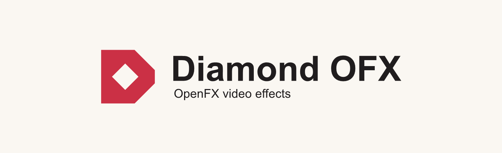

# Diamond OFX

Personal project. vibe coded this with AI because I wanted camera shake for my VEGAS edits and not spend 80 USD on a certain plugin.

**[Download v0.03](https://github.com/Witoree/diamond-ofx/releases/tag/v0.03)** for Windows x64. Close VEGAS and copy `Diamond.ofx.bundle` from the Win64 ZIP to `C:\Program Files\Common Files\OFX\Plugins\`. Reopen VEGAS and look under **Video FX → Diamond**. [All releases](https://github.com/Witoree/diamond-ofx/releases) · [Install guide](docs/INSTALL.md)

The effects render on the CPU.

## Effects

`D_Shake`, `D_LensFlare`, `D_Glow`, `D_BlurMoCurves`, `D_DigitalDamage`, `D_Rays`, `D_UltraZap`, `D_PixelSort`, `D_RackDefocus`, `D_LightLeak`, and `D_FilmEffect`.

[Changelog](CHANGELOG.md) · [Build](docs/BUILD.md) · [Contribute](CONTRIBUTING.md) · [MIT license](LICENSE.txt) · [OpenFX license](third_party/openfx/LICENSE.md)
